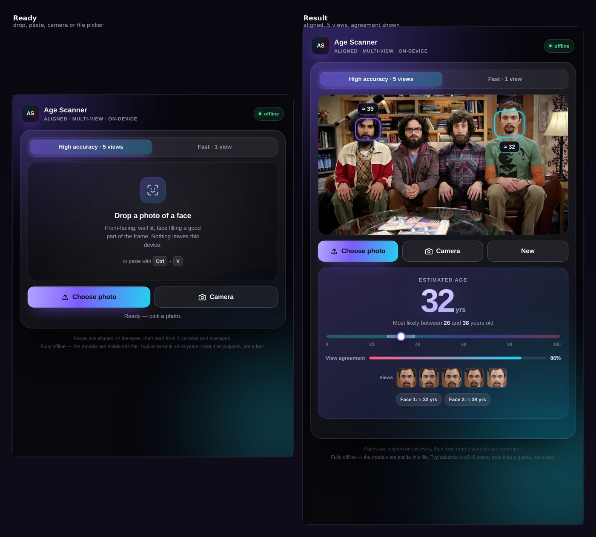
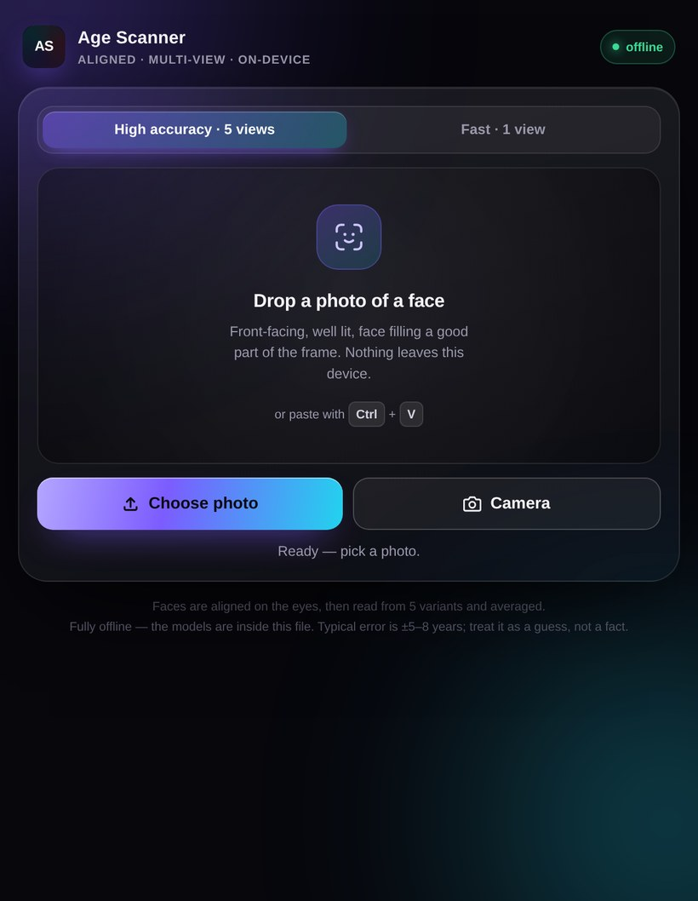

# Age Scanner

A face-age estimator that runs entirely in your browser. Open the file, drop in a photo, and it finds the face and estimates the age — no server, no upload, no internet connection.

## Download

**[⬇ AgeScanner-v1.0.apk (906 KB)](https://github.com/technicalnihilist-lgtm/age-scanner/releases/download/v1.0/AgeScanner-v1.0.apk)** — signed Android app, minSdk 24. No `INTERNET` permission at all.

**Or run it in the browser:** https://technicalnihilist-lgtm.github.io/age-scanner/

## What's in here

| File | What it is |
| --- | --- |
| `AgeScanner.html` | The real app. Photo → detected face → estimated age. |
| `AgeGuesser.html` | A bonus: a 12-question lifestyle quiz that guesses your age without any photo. |
| `android/` | Source of the APK — a WebView shell, three files and a build script, no Gradle. |

Both are single self-contained HTML files. Double-click either one and it runs from your local disk.

## How the scanner works

1. **Detect** — a Tiny Face Detector finds every face in the photo. If the shot is cropped too tightly for the detector, it retries once on a padded copy and maps the boxes back.
2. **Align** — a 68-point landmark model locates the eyes; the face is rotated and scaled so the eyes land on fixed template positions and cropped to 224×224, the size the age network was trained on.
3. **Read 5 views** — the aligned crop is read five times: original, mirrored, zoomed in, zoomed out, brightened. Results are averaged with outliers rejected.
4. **Report** — estimated age, a likely range, and a "view agreement" score that says how closely the five views matched.

Switch to **Fast · 1 view** to skip the ensemble.

## Honest accuracy note

This is a guess, not a measurement. The underlying age network is small (about 430 KB) so it fits inside a single HTML file, and small age models carry a systematic bias — they tend to pull estimates toward young adulthood. On a labelled test photo of a 30-year-old it answered 22. Typical error on adults is roughly ±5–8 years, and it is weaker for children and for faces at an angle.

Alignment and multi-view averaging make the output steadier and stop it failing outright; they do not remove the model's bias. If you need real accuracy, use a much larger model and accept a much larger download.

The "view agreement" percentage measures how closely the five views agree with each other. It is **not** a probability of being correct.

## Practical notes

- Speed depends on your graphics hardware. With normal GPU acceleration a scan takes a second or two; browsers that fall back to software rendering are much slower, and the app says so instead of spinning forever.
- Opening the camera from a local file is sometimes blocked by browser security rules. Drag-and-drop, the file picker and Ctrl+V paste always work.
- Everything runs locally. Nothing is sent anywhere, and there is no network code in the app at all.

## Built with

- [face-api.js](https://github.com/justadudewhohacks/face-api.js) (MIT) — detector, landmark and age networks, running on TensorFlow.js.
- Model weights are embedded inside the HTML as base64, served to the library through a patched `fetch`, so the app never touches the network.

## License

**MIT** — see [LICENSE](LICENSE). Fork it, ship it, sell it, change it; just keep the copyright notice.

Bundled third-party parts keep their own licences:

- [face-api.js](https://github.com/justadudewhohacks/face-api.js) — MIT (detector, landmark and age networks, and their weights)
- [TensorFlow.js](https://github.com/tensorflow/tfjs) — Apache-2.0 (bundled inside face-api.js)

## Contributing

Issues and pull requests are welcome. The most useful contribution right now would be a better age model: the current one is small enough to live inside a single HTML file, and it shows. See the accuracy note above.
